# Efficient Neural Network Architectures for Vehicle Type Classification — Engineering Guide

Developed and evaluated neural network architectures for vehicle type classification using the VTID2 image dataset. The evaluated architectures included an MLP, a standard CNN, an efficient depthwise-separable CNN, and an efficient CNN with Squeeze-and-Excitation.

**Author:** Mohammed Mahyoub · [ORCID 0009-0003-5640-352X](https://orcid.org/0009-0003-5640-352X) · [Web case study](https://mahyoub88.github.io/projects/proj-vtid2/)

## Visual overview

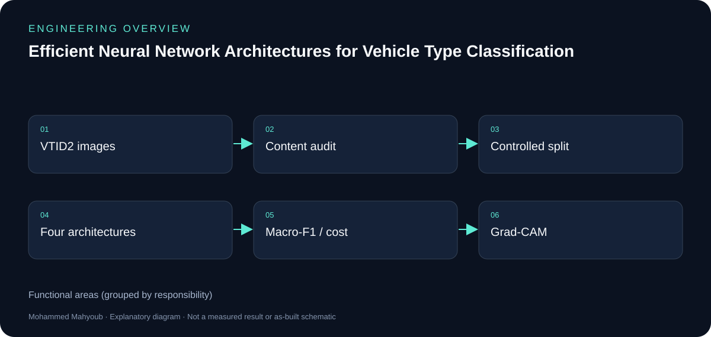

*New explanatory diagram; grouped responsibilities, not an as-built schematic or test result.*

*New explanatory workflow; a documentation aid, not evidence that every proposed check was performed.*

## Data quality before accuracy

The content audit found 4,356 valid images, of which 2,425 were redundant exact copies (55.67%). The remaining 1,931 exact-unique images make clear why evaluation design matters: copies can cross an image-level train/test boundary and inflate apparent generalisation. Near-duplicates were screened with perceptual hashing and verified with SSIM, then grouped so that visually related images never straddle a split.

## Architecture comparison

The MLP establishes a non-convolutional baseline. A standard CNN is compared with a depthwise-separable CNN and a version with Squeeze-and-Excitation. The comparison considers Macro-F1 together with trainable parameters, multiply-accumulate operations and batch-one inference latency.

## Interpretation of results

Under a conventional image-level protocol with duplicates retained, the Standard CNN reached a Macro-F1 of 0.9835 ± 0.0017; under the leakage-controlled protocol it reached 0.8526 ± 0.0154. The two protocols also differ in data composition and training settings, so the gap is a diagnostic comparison, not a causal estimate of leakage.

Relative to the Standard CNN, the Efficient CNN reduced trainable parameters by 87.24% and MACs by 81.67%, with 8.49% lower CPU and 18.32% lower GPU batch-one latency, while mean Macro-F1 was 0.0150 lower. Adding Squeeze-and-Excitation did not improve mean test performance and increased measured latency.

## Explainability

Grad-CAM was applied across the held-out test set to examine attention to vehicle regions and to letterbox padding. Padding attention stayed below the geometric null; however, padding geometry itself encodes aspect ratio, so it is not a fully neutral artefact.

## Reproducibility

The repository contains the executed Jupyter notebook and `requirements.txt`. The VTID2 dataset is not redistributed; obtain it from its original source and update the dataset and output paths before running the cells in order. Fixed seeds and group-aware splitting are used, but results can vary slightly across hardware and library versions.

## Source gallery

All figures below are outputs of the executed notebook in this repository.

### Figure 1

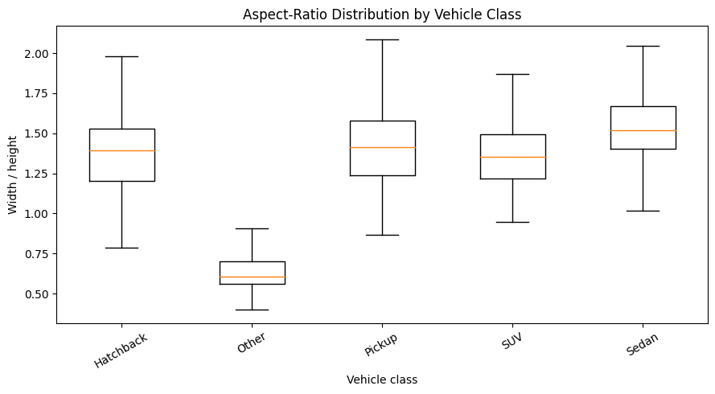

*Aspect-ratio (width/height) distribution by vehicle class. The “Other” class is the only one taller than it is wide, which later matters for letterbox padding.*

### Figure 2

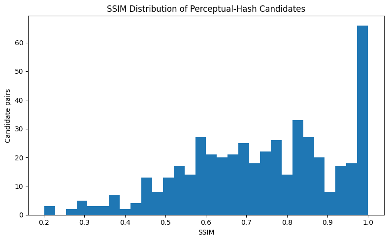

*SSIM distribution across perceptual-hash candidate pairs; a large mass near 1.0 signals visually near-identical images.*

### Figure 3

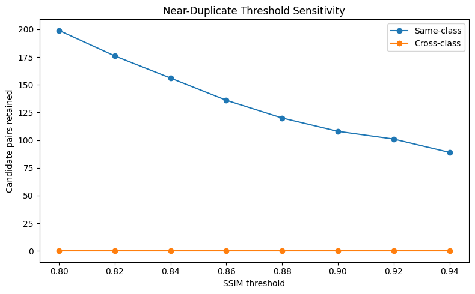

*Retained near-duplicate candidate pairs as the SSIM threshold rises from 0.80 to 0.94. Same-class pairs dominate; cross-class pairs stay at zero.*

### Figure 4

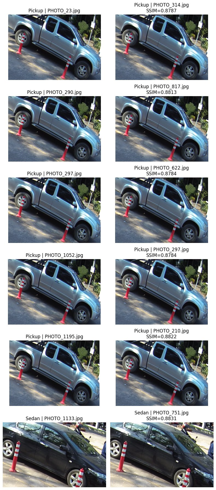

*Verified near-duplicate pairs around the selected SSIM threshold — the same vehicle captured in near-identical frames.*

### Figure 5

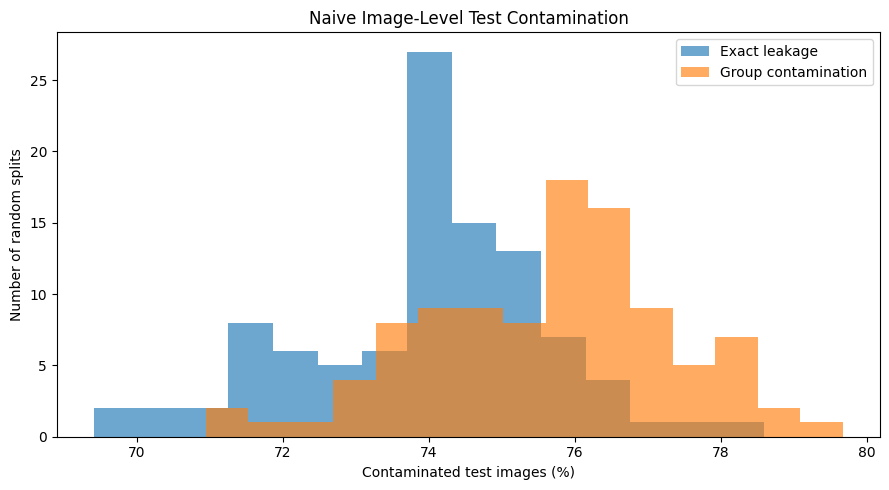

*Under random image-level splits, roughly 70–80% of test images are contaminated by exact leakage or group contamination.*

### Figure 6

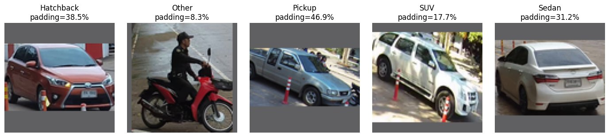

*Neutral letterbox preprocessing applied to one example per class, with the mean padding share of each class.*

### Figure 7

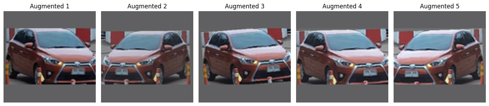

*Training-only augmentation examples generated from a single source image.*

### Figure 8

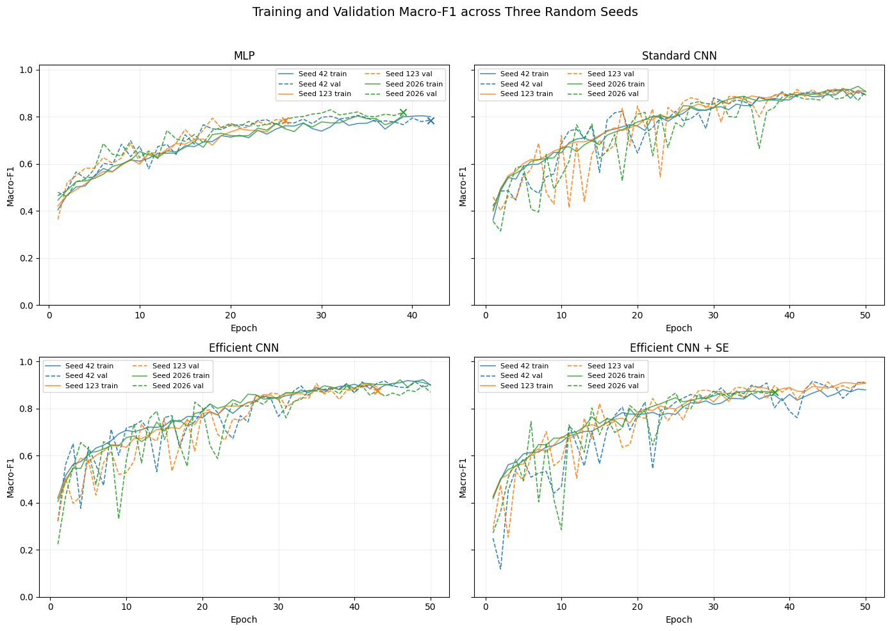

*Training and validation Macro-F1 across three random seeds for the four architectures.*

### Figure 9

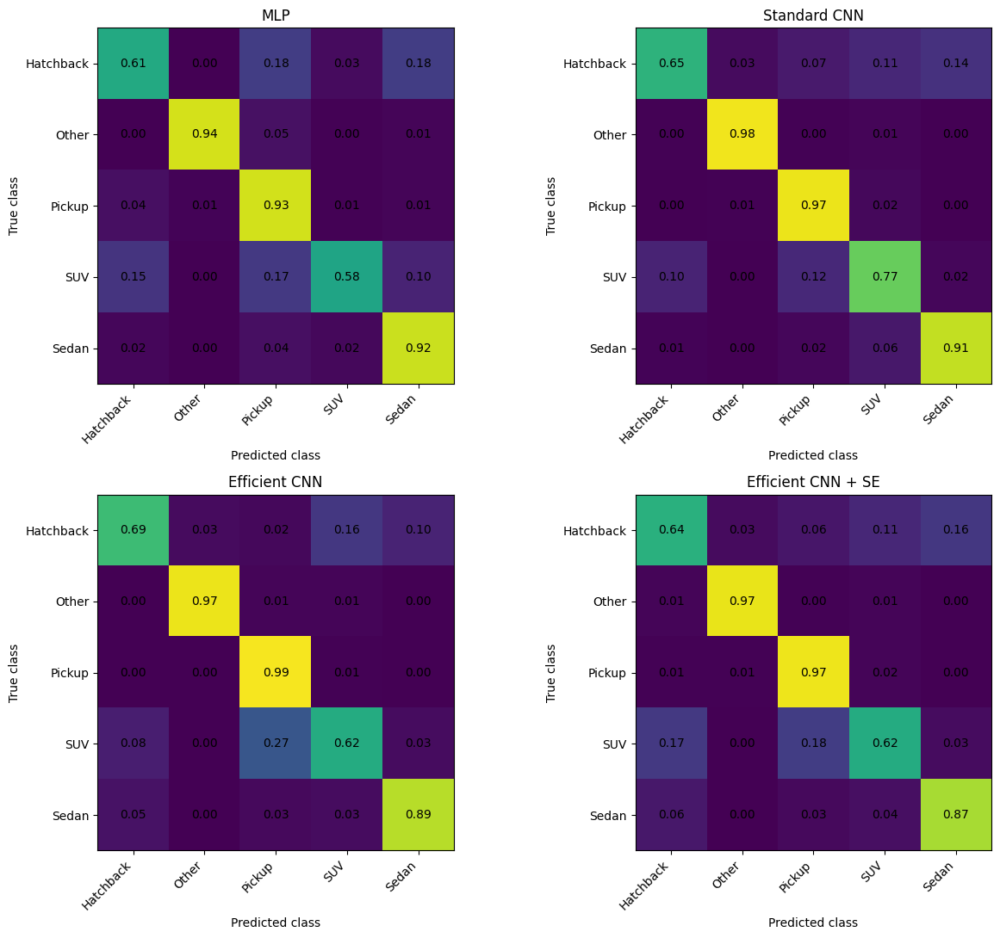

*Row-normalised held-out test confusion matrices for the MLP, Standard CNN, Efficient CNN and Efficient CNN + SE.*

### Figure 10

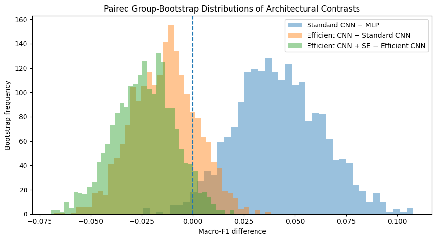

*Paired group-bootstrap distributions of Macro-F1 differences for the three architectural contrasts.*

### Figure 11

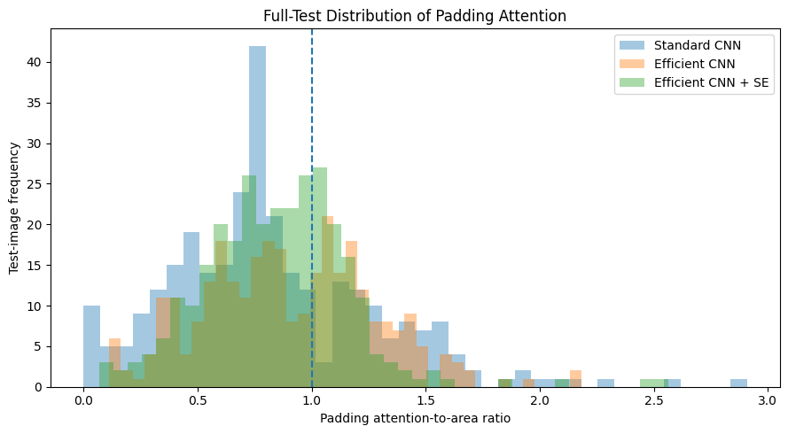

*Full-test distribution of the padding attention-to-area ratio; the dashed line marks the geometric null (1.0).*

### Figure 12

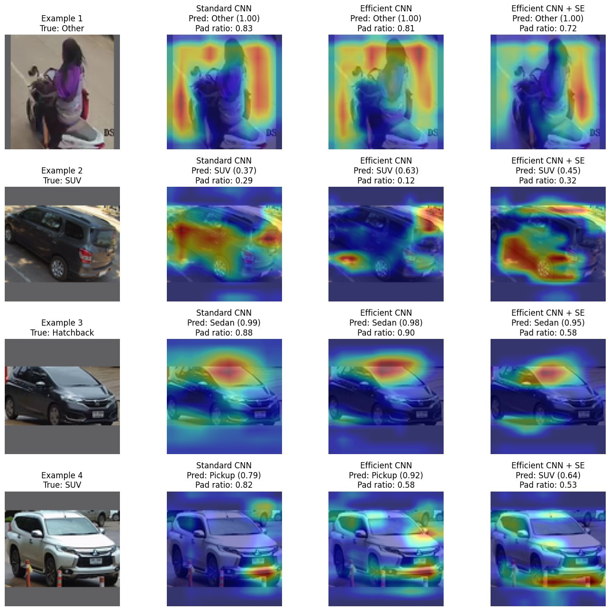

*Illustrative Grad-CAM examples for the three convolutional models, with predicted class, confidence and padding ratio.*

## Sources and provenance

- [Executed notebook](../VTID2_Efficient_Vehicle_Type_Classification.ipynb) — source of every gallery figure and reported figure.
- [Web case study](https://mahyoub88.github.io/projects/proj-vtid2/).
- [Grad-CAM — original research paper](https://arxiv.org/abs/1610.02391).
- The architecture and workflow SVGs are explanatory diagrams authored for documentation; they are not measured results.
